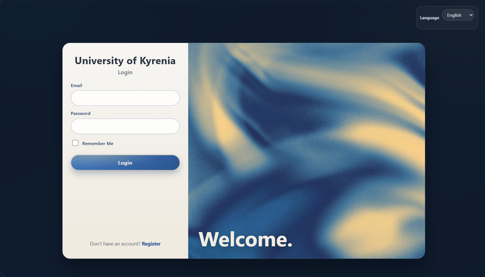
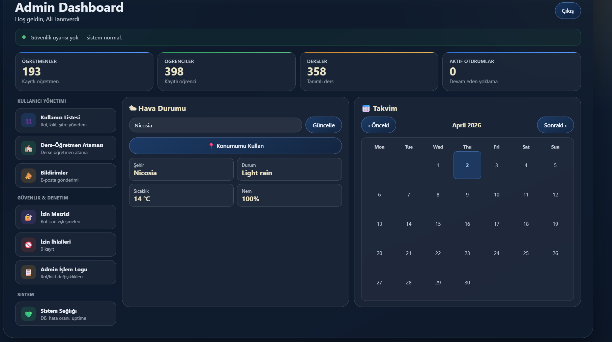
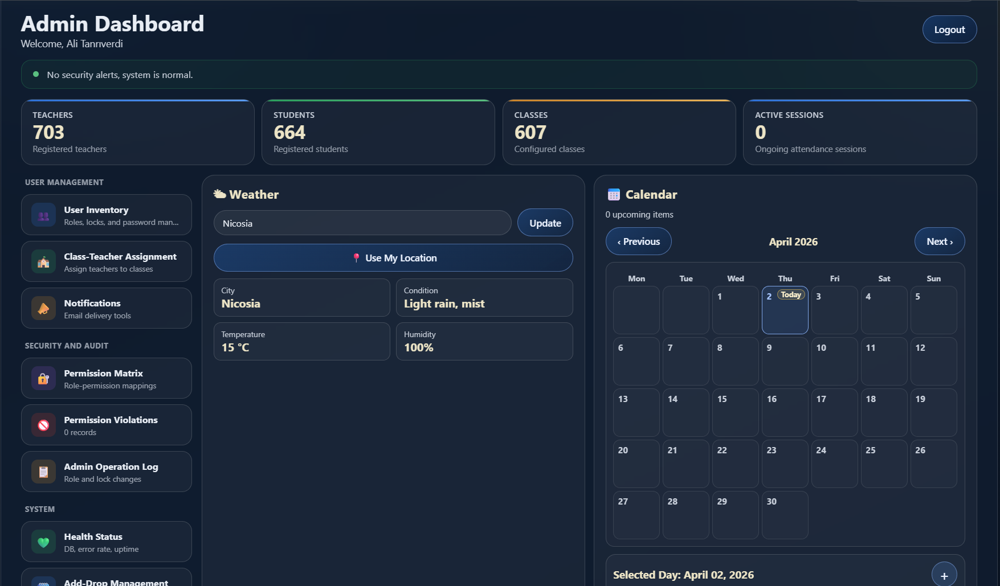
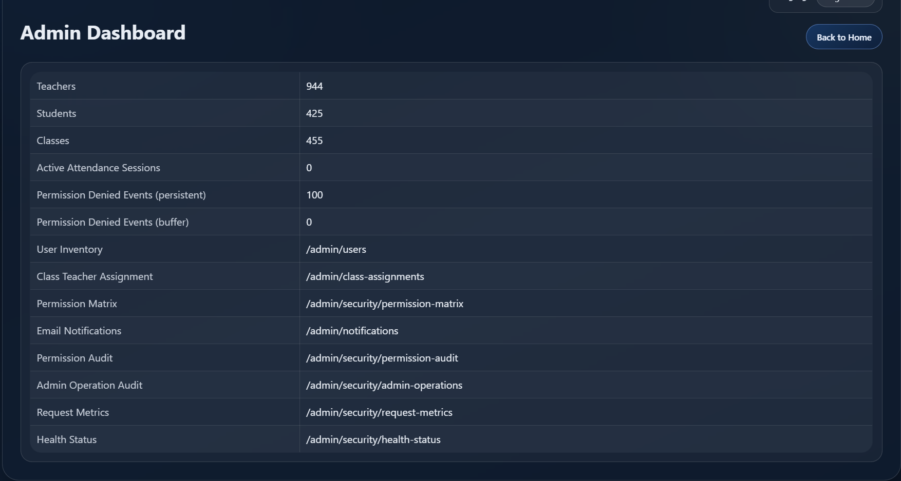
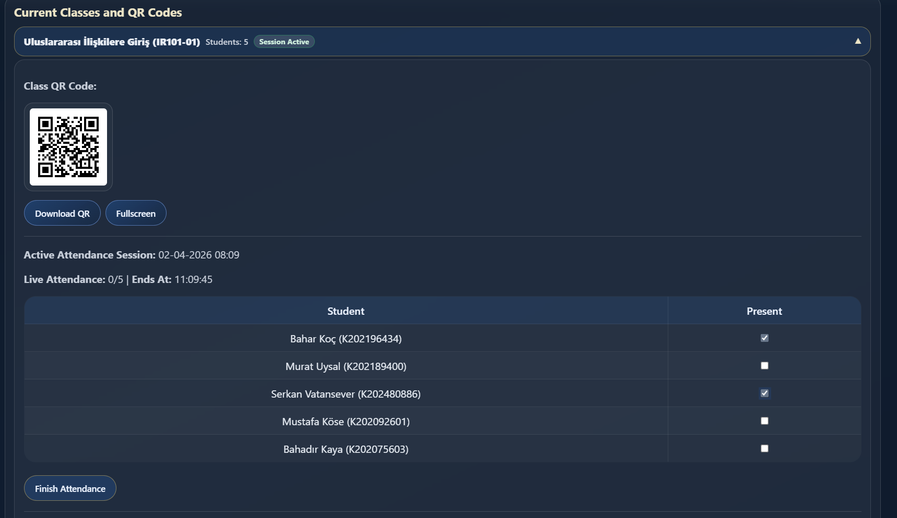
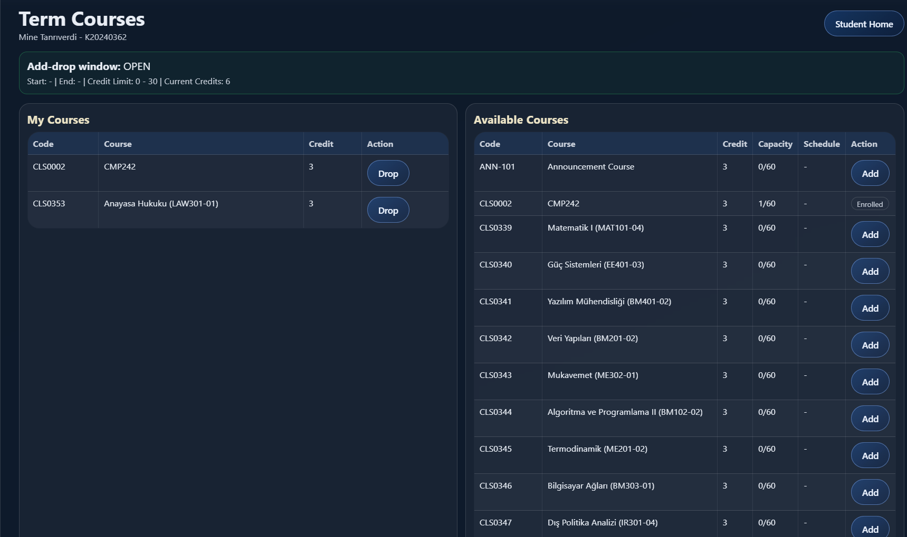

# QR Attendance & Academic Management System

A Flask web application for QR-code based class attendance, combined with a student / teacher / admin academic portal. The interface is available in Turkish and English.

## Features
- **QR attendance:** each class has its own QR code. The teacher starts a session, and students scan the code with their phone to be marked present within the attendance window.
- **Teacher:** class and session management, manual attendance edits, session statistics, class history with CSV export, grade entry and course rosters.
- **Student:** dashboard with attendance and absence tracking, term course registration, transcript, exams, academic calendar and profile pages.
- **Admin:** user management (roles, lock / unlock, password reset), class–teacher assignment, course registration window, announcements and email notifications, permission matrix, audit logs, health and request metrics.
- **Shared:** role- and course-targeted announcements, personal calendar events, weather widget on dashboards.
- **Security:** role-based permissions with ownership checks, CSRF protection, login rate limiting and account lockout, audit logging.

## Tech Stack
- Python 3.14, Flask 3, Flask-SQLAlchemy / SQLAlchemy 2
- PostgreSQL (psycopg2), Alembic migrations
- Jinja2 server-rendered templates
- qrcode + Pillow for QR images
- pytest

## Quick Start (Windows PowerShell)
Requirements: Python 3.14+ and a running PostgreSQL server.

1. Create and activate a virtual environment, then install dependencies:

```powershell
python -m venv .venv
.\.venv\Scripts\Activate.ps1
pip install -r requirements.txt
```

2. Create an empty PostgreSQL database (e.g. `attendance`) and configure the environment:

```powershell
Copy-Item .env.example .env
# edit .env: set DATABASE_URL and FLASK_SECRET_KEY
```

3. Load demo data (optional but recommended):

```powershell
python scripts/seed_production_data.py --yes
```

4. Run the app and open http://127.0.0.1:5000:

```powershell
python app.py
```

Tables are created automatically on first start.

## Demo Accounts
Created by `scripts/seed_production_data.py`:

| Role    | Email                             | Password       |
|---------|-----------------------------------|----------------|
| Admin   | `demo.admin@kyrenia.edu.tr`       | `Admin.12345`  |
| Teacher | `demo.ogretmen@kyrenia.edu.tr`    | `Ogretmen.123` |
| Student | `demo.ogrenci@std.kyrenia.edu.tr` | `Ogrenci.123`  |

The seed also creates 100 teachers and 350 students with realistic data (all teachers: `Ogretmen.123`, all students: `Ogrenci.123`). The demo student is enrolled in all of the demo teacher's classes, so the QR flow can be tried end to end.

To promote an existing account to admin on a fresh database: `python scripts/bootstrap_first_admin.py --email you@example.org`.

## Scanning QR Codes with a Phone
QR codes encode `QR_BASE_URL` (default: `http://<this computer's LAN IP>:5000`). Keep the phone on the same network as the computer running the app; set `QR_BASE_URL` in `.env` if the detected address is wrong. QR images are regenerated at startup into `static/qrcodes/`.

## Configuration
All settings are environment variables, documented in [.env.example](.env.example). Only `DATABASE_URL` is required (PostgreSQL; `postgres://` is normalized to `postgresql://`). Values set in the shell override `.env`. Email is in dry-run mode by default (messages are logged, not sent).

## Testing

```powershell
python -m pytest tests
```

Tests never touch the main database: `tests/conftest.py` switches to `TEST_DATABASE_URL`, or to `<main database>_test`, and creates it if needed.

Translation check (Turkish / English keys):

```powershell
./check_i18n.ps1
```

## Database Backup

```powershell
python scripts/backup_db.py --keep 10
pg_restore --clean --if-exists -d <DATABASE_URL> backups/<file>.dump
```

## Project Structure

```
app.py                 application: config, security, routes, i18n
models.py              SQLAlchemy models
env_config.py          .env loading and DATABASE_URL resolution
templates/             Jinja templates (<role>_<page>.html)
static/                CSS/images; generated QR codes in static/qrcodes/
migrations/            Alembic migrations
scripts/               demo data, first-admin bootstrap, database backup
tests/                 permission/security and UI smoke tests
docs/                  user and developer guides
```

## Documentation
- [User guide](docs/USER_GUIDE.md)
- [Developer guide](docs/DEVELOPER_GUIDE.md)

## Screenshots

### Login


### Admin Dashboard (TR)


### Admin Dashboard (EN)


### Admin Health Status


### Teacher Attendance and QR


### Student Term Courses


## License
Internal project repository.
